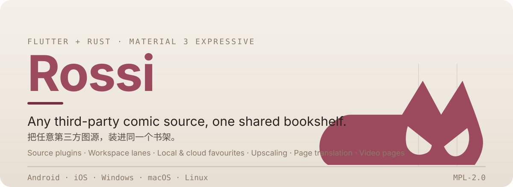
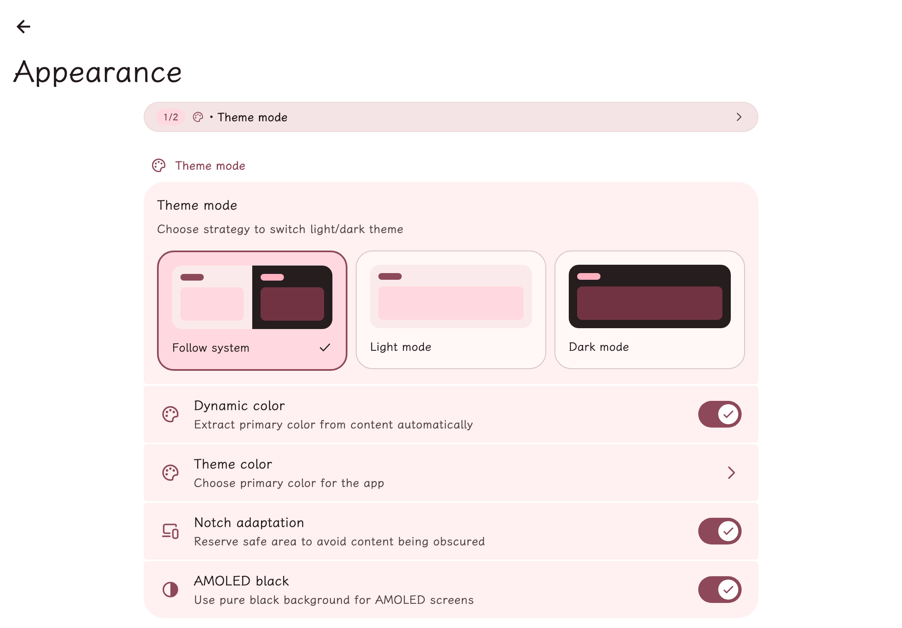
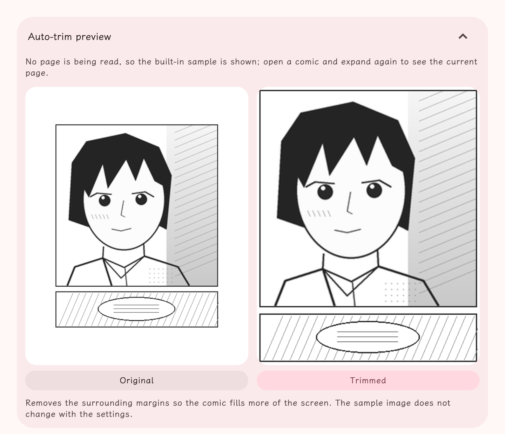
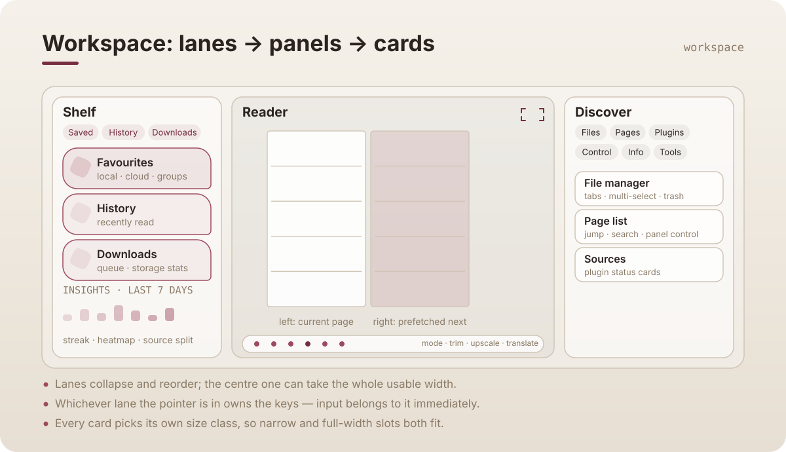
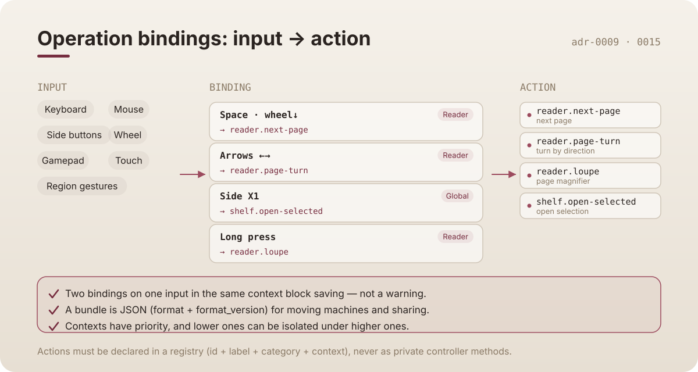
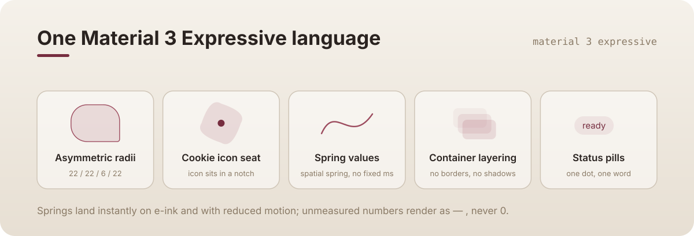
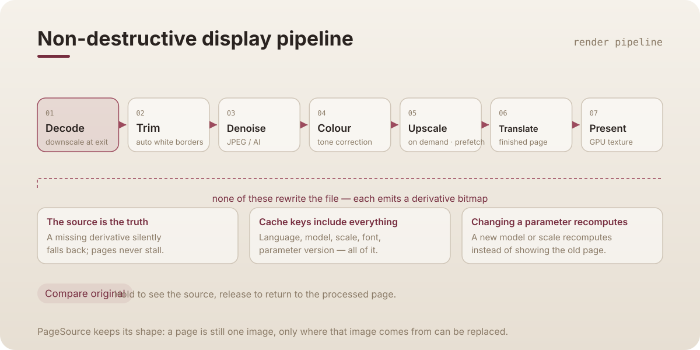
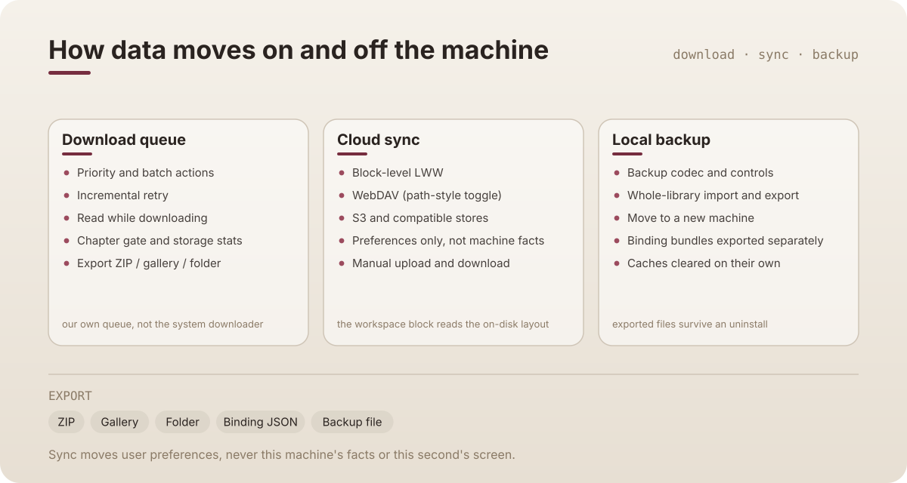

<a id="top"></a>

<p align="center">
  
</p>

<p align="center">
  <a href="./README.md">中文</a> · <b>English</b>
</p>

## What Rossi is

A cross-platform manga reader written in **Flutter + Rust**.

It ships **no comic content at all** — where the comics come from is entirely up to **plugins**. One JS file describes how to list, how to search and how to restore the images; a QuickJS sandbox on the Rust side runs it. Install a plugin and that source becomes readable; install none and it stays a clean bookshelf for local CBZ files.

Two plugins, Bika and JM, are built in: `rust/build.rs` downloads their bundles at compile time, so the first run already works. The interface is **Material 3 Expressive**: asymmetric radii, spring-driven numbers and container layering, not a pile of hairline borders.

---

## What it does

### Sources and search

- Bika and JM built in; install your own `.js` / `.cjs` / `.br` plugins, or pull them from the [plugin list](https://github.com/deretame/Breeze-plugin-list) — one-tap download, manual update, drag to reorder.
- **Aggregate search** asks several sources in one go. Tag syntax and excluded terms are supported, and searches are kept in history.
- The EHentai tag dictionary ships with the app, bilingual, so you don't have to guess tag names.
- Local CBZ / ZIP archives read directly, with no extraction step.

### Reading

- Six modes: right to left (Japanese order, unmirrored), left to right, webtoon top to bottom, double page (seamless, optional leading blank), split landscape pages, auto read.
- **Every comic can override the settings** without touching the global set.
- Page magnifier, manual page order, slideshow auto-turn, chapter read marks; e-ink tuning, volume-key turns, left/right hand mode, ambient background, thumbnail scrubbing, persistent control bar.
- Desktop bindings are fully editable: keyboard, mouse, side buttons, wheel, gamepad, touch and region gestures, in separate global and reader contexts; in the reader there is also a honeycomb **radial menu**.

### Workspace

- On desktop the app is **lanes → panels → cards**: the left lane is the shelf (saved / history / downloads / insights), the centre is the reader, the right lane is discovery (file manager / page list / sources / control / info / tools).
- The centre lane can **take the whole usable width** in one tap; lanes collapse and reorder, and whichever lane the pointer is in owns the keys.
- Every card picks its own size class: the same card fits a narrow slot and a full-width one, and numbers it cannot measure render as "—", never 0.

### Bookshelf and downloads

- Favourites come in **local** and **cloud** kinds and can be grouped; the shelf has an "exhibit wall" layout (hero, sections, asymmetry) with one tap back to a plain list.
- The follow tab lists exactly what updated but has not been read yet, with chapter read marks and follow statistics.
- A custom download queue: priority and batch actions, incremental retry of failures, read while downloading, chapter gate, storage stats; export to ZIP / gallery / folder and re-import.
- **WebDAV and S3 sync** (with a path-style toggle) merging per block with LWW — it moves user preferences, it does not overwrite what another machine knows about itself.

### Picture quality

- Four super-resolution routes, and the app picks a working one per platform: Rossi native CoreML (ANE / GPU), mImage ONNX (DirectML / CoreML EP / CPU), desktop NCNN (waifu2x, Real-CUGAN), and the bundled waifu2x CLI on Android.
- Only runs below a resolution you set, prefetches pages on both sides of the current one, and recomputes the cache when you change model or scale instead of keeping the old result on screen.
- Weights are not bundled; they download on first use.

### Manga translation (finished pages)

- Detect → recognize → erase → translate → re-typeset, producing a **redrawn page**, not subtitles laid over the original.
- Three translation engines to choose from: an API endpoint (cloud, or local Ollama / Foundry Local), local Hunyuan Hy-MT2, and Apple's system translation (on-device, offline, free).
- Glossary: one `source=target` per line, so proper nouns stay where you put them.
- Windows / Linux / macOS only for now — see [this section](#translation-details).

### Data and sync

- Local backup codec with whole-library import and export; binding bundles export to JSON separately, which is how you move machines or share a layout.
- Caches can be cleared on their own without touching the originals; backup files written to disk survive an uninstall.
- In-app update check and changelog; 20 preset theme colours (the default one is the mask red from the icon), light/dark following the system, dynamic colour, and importable tweakcn / shadcn themes.
- Custom reading font; GitHub / jsdelivr acceleration proxies; gesture and PIN app lock; per-item notification switches.
- System tray on macOS and Linux.

---

## Screenshots

Two screens from the real app, rendered by Flutter itself (see [`tool/readme_shots`](./tool/readme_shots)):

<p align="center">
  
  
</p>

The settings page uses the same language from shell to group card: `SettingGroup` owns the group surface, no `Divider` sits between rows, and switches carry their own checked state. The processing comparison uses the bundled sample images rather than a runtime capture.

---

## How it runs

<p align="center">
  
</p>

The chain is `Dart → Flutter Rust Bridge → Rust → QuickJS`. Plugin code never runs inside Dart and never touches platform APIs: it can only describe which request to send, how to parse the answer and how to restore the image. Network and file capabilities are granted per feature by the host.

> ⚠️ **Plugins are still beta** — the API may change substantially, and today it suits learning better than shipping.
> But remember: inside the sandbox a plugin can still make network requests and read or write files. **Installing a plugin means trusting the code it contains.**

- Plugin development docs: <https://deretame.github.io/plugin-dev-docs/>
- Plugin list: <https://github.com/deretame/Breeze-plugin-list>

---

## Workspace: lanes → panels → cards

<p align="center">
  
</p>

Three lanes, each owning a strip of panels, each panel holding cards. A card works in a narrow slot and at full width because it chooses its own size class inside `LayoutBuilder` — the outside never scales it.

"Which lane gets my keys" and "is that lane fully on screen" are two separate questions: input belongs to the lane under the pointer immediately, without waiting for the pull-in animation; whether the lane should be fully revealed is judged independently.

---

## Operation bindings: one action, seven input classes

<p align="center">
  
</p>

An action is not a private controller method but a row in a registry (id + label + category + context). A binding maps an input descriptor to an action id, and a conflict **blocks saving** rather than raising a warning — the user has no way to judge which one should give way.

A bundle is JSON with `format` and `format_version`; it is how you move machines, back up or share a layout. Without it, high customisability would just be un-migratable configuration debt.

---

## One Material 3 Expressive language

<p align="center">
  
</p>

Workspace, settings, the radial menu and toasts share one implementation: the same radius numbers, one spring behind every animated value, and layering built from `ColorScheme` container pairs instead of borders and shadows.

On e-ink and with reduced motion the springs land instantly — animation is a bonus, never a precondition for usability.

---

## Six ways to read

<p align="center">
  
</p>

Direction, page turning, double-page pairing and auto-scroll intervals each have more than one switch, so the model is one global set plus a per-comic override. Desktop adds a complete binding editor.

---

## Four super-resolution routes

<p align="center">
  
</p>

A tick means **this route actually runs on this platform**. You don't have to memorise the table to pick an engine: the default is the recommended option among the ones your platform supports. If a setting synced in from another platform names an engine that cannot run here, it falls back to the default instead of erroring.

---

## The non-destructive display pipeline

<p align="center">
  
</p>

Trim, denoise, colour correction, upscaling and translation **never rewrite the file**; each emits a derivative bitmap. A missing or cleared derivative silently falls back to the source instead of stalling a page turn, and changing model, scale or font recomputes the cache rather than showing you the old result.

Cache keys must include every input that affects the output — target language, model, scale, font, parameter versions. Miss one and you get the classic "changed the model, page is still old" silent bug.

---

<a id="translation-details"></a>

## Manga translation (finished pages)

<p align="center">
  
</p>

Unlike overlaying a translation, this path **erases the original text from the image** and re-typesets the translation into the shape of the bubble, so what you get is a page you can simply read. In the reader toolbar, tap Translate to switch the current page only.

Limits worth knowing:

- **Desktop only.** Android and iOS are excluded on purpose, not left on a backlog: this repo's ONNX Runtime registers no accelerator EP for the linux/android sections, and the recognizer is an fp32 ViT + BERT — making it usable on mobile needs an int8 re-export first. So the entry point is not drawn at all on mobile, rather than drawn and then erroring.
- Weights are not bundled: about **660 MB**, downloaded from the settings page on first use (PP-OCRv4 det + manga-ocr recognition + LaMa erase).
- Each engine trades something off: the API endpoint needs network or a local service and supports the glossary; Hunyuan Hy-MT2 needs you to start `llama-server` yourself; Apple system translation is on-device, offline and free, but **exposes no glossary API**, so on that route proper nouns get the generic translation.
- If the endpoint is unavailable at that moment the page **degrades**: it is erased and re-typeset with the source text instead of stalling the whole chapter.
- Finished pages are cached, and there is a one-tap clear after changing model or font (your originals are never touched).
- All six stages write one log line per page, so when something goes wrong the settings page shows you which stage.

---

## How data moves on and off the machine

<p align="center">
  
</p>

Sync moves user preferences, never this machine's facts or this second's screen. That boundary is the whole reason the block table exists: the `workspace` block reads the on-disk layout file, so adding a layout switch does not require touching sync code.

---

## Download and install

Go to the [Releases page](https://github.com/deretame/Breeze/releases) and pick your platform:

| Platform | File | Install |
| :--- | :--- | :--- |
| Android / HarmonyOS | `app-arm64-v8a-release.apk` | Install directly |
| Windows | `windows-installer.exe` | Double-click |
| macOS | `Breeze-macOS.dmg` or Homebrew | `brew install --cask breeze` |
| Linux | `breeze.flatpak` or `breeze_*.deb` | Flatpak / apt |
| iOS / iPadOS | `Breeze-iOS.ipa` | Sideload and re-sign yourself |

<details>
<summary><b>Android / HarmonyOS</b></summary>

Download `app-arm64-v8a-release.apk` and install it directly.

> **Note**: in mainland China an unreviewed app may refuse to install. [GBox](https://gboxlab.com/i18n/zh-Hant/), [出境易](https://www.chujingapp.com/) or [GSpace](https://gspaceteam.com/) (all available in the HarmonyOS app store) work around the system installer.

</details>

<details>
<summary><b>Windows</b></summary>

Download `windows-installer.exe` and run it to install.

Running the Rust-compiled parts locally needs Visual Studio (C++) or an equivalent GCC toolchain.

</details>

<details>
<summary><b>macOS</b></summary>

**Option 1: Homebrew (recommended)**

```bash
brew tap deretame/breeze
brew install --cask breeze

# upgrade
brew upgrade breeze

# remove completely, including database, cache and configuration
# note: files you exported by hand are kept, but in-app data is wiped
brew uninstall --zap breeze
```

**Option 2: install the DMG manually**

1. Download the latest `Breeze-macOS.dmg`.
2. Open it and drag `Breeze.app` into `Applications`.

> ⚠️ **First launch (Gatekeeper)**
> This is free open-source software and carries no Apple developer signature. If macOS says the app is **damaged** or **cannot be verified**, run this in Terminal and it will open normally:
>
> ```bash
> xattr -cr /Applications/Breeze.app
> ```
>
> Alternative: in the Applications folder, hold `Control` and click the app icon, then choose Open from the context menu.

</details>

<details>
<summary><b>Linux</b></summary>

Both Flatpak and DEB packages are published.

**Option 1: DEB** (Debian/Ubuntu and derivatives)

Current releases publish `amd64` DEB only.

```shell
# if the downloaded DEB is the only one in this directory, a glob works
sudo apt install ./breeze_*.deb

breeze                    # start
sudo apt remove breeze    # remove
```

`apt` resolves the system dependencies for you. Afterwards start **Breeze** from the application menu, or run `breeze` in a terminal.

> **Note**: the DEB is not guaranteed to work on every Debian/Ubuntu derivative. If install or startup misbehaves, use the Flatpak build.

**Option 2: Flatpak**

1. If Flatpak is not set up yet, see the [Flathub quick setup guide](https://flathub.org/zh-Hans/setup).
   From mainland China, the [CERNET mirror](https://help.mirrors.cernet.edu.cn/flathub/) is considerably faster.
2. This project builds against the GNOME 50 runtime, so install that first:

   ```shell
   flatpak install flathub org.gnome.Platform//50
   ```

3. Download `breeze.flatpak` from the release and install it:

   ```shell
   flatpak install --user breeze.flatpak
   ```

4. Run it:

   ```shell
   flatpak run io.github.windy.breeze
   ```

</details>

<details>
<summary><b>iOS / iPadOS</b></summary>

iOS is closed: anything not from the App Store has to be **sideloaded and re-signed by you**. Download the unsigned `Breeze-iOS.ipa`, then install it with one of the tools below.

**Recommended: AltStore** — currently the most stable and the friendliest to newcomers, and it re-signs automatically over the local network from a computer.

- Site: <https://altstore.io/>
- [Official AltStore walkthrough](https://faq.altstore.io/)
- [知乎: AltStore-based self-signing tutorial (Chinese)](https://zhuanlan.zhihu.com/p/143936759)
- [哔哩哔哩: unlimited self-signed IPA on iOS (Chinese)](https://b23.tv/UbuuJTZ)

**Other self-signing / no-sign options**

- **Sideloadly**: no jailbreak, desktop self-signing tool for Windows and macOS. [Site and guide](https://sideloadly.io/)
- **TrollStore**: if your iOS version is within the exploit's range, **strongly recommended** — permanent unsigned installs that never drop their signature. [Supported versions and install guide](https://ios.cfw.guide/installing-trollstore/)

</details>

---

## Building from source

> For anyone changing the code. If you only want to read, you can stop above.

### 1. Core toolchain

- **Flutter SDK**: must pass `flutter doctor`.
- **Rust toolchain**: install via `rustup` and add the cross-compilation targets you need (for example `aarch64-linux-android`).
- **LLVM / Clang**: libraries such as `rustqjs` parse C headers, so LLVM is required (on Windows, `choco install llvm` or the upstream installer), with `LIBCLANG_PATH` configured.

### 2. Environment variables

| Variable | Why | Example path |
| :--- | :--- | :--- |
| **JAVA_HOME** | Required to build Android, Windows and Linux | `C:\Program Files\Android\Android Studio\jbr` |
| **ANDROID_NDK_HOME** | Required to cross-compile the Rust library for Android | `...\AppData\Local\Android\Sdk\ndk\29.0.14206865` |
| **LIBCLANG_PATH** | Used by `bindgen` (Rust) to generate FFI bindings | `C:\Program Files\LLVM\bin` |

> Make sure `javac` and `clang` are both on `PATH`.

### 3. Dependencies and code generation

```bash
# root project Flutter dependencies
flutter pub get

# required again after touching auto_route / freezed / json_serializable / objectbox / FRB
dart ./script/code_generate.dart
```

### 4. Docs and artwork

The README SVGs are generated, one file per language — don't edit the output by hand:

```bash
python3 script/build_readme_svgs.py          # rewrite assets/readme/*.svg
python3 script/build_readme_svgs.py --check  # verify they are up to date
```

Screenshots work the same way: Flutter renders the real pages itself, no screen-capture tool involved:

```bash
flutter test --update-goldens tool/readme_shots/readme_shots_test.dart
```

### 5. Platform notes

- **Android**: point `local.properties` at the right SDK path.
- **Windows / Linux**: install Visual Studio (C++) or an equivalent GCC toolchain so the Rust parts can compile locally.
- **Repository layout, build scripts and conventions**: see [`AGENTS.md`](./AGENTS.md) and [`docs/`](./docs/).

---

> A short English summary of the disclaimer below, for convenience. **The Chinese text is the authoritative version.**
> The app is provided as-is with no warranty of any kind; the developer is not liable for any damage from using, modifying or redistributing it. You are responsible for checking that your use is lawful where you are, and for the content any third-party plugin fetches — the app itself ships none. External contributions represent their authors only. Keep working on a plugin's source before installing it: it runs code you did not write.

---

## 💖 Credits

| [](https://sentry.io/) | Error monitoring for this project is sponsored by **[Sentry](https://sentry.io/)**; its Sponsored Business plan helps us catch and fix crashes faster. |
| :--- | :--- |

Thanks also to **[Aidoku](https://github.com/Aidoku/Aidoku)**, whose approach to image upscaling on iOS / macOS informed this project's implementation.

---

## License

Released under the **Mozilla Public License 2.0** — see [LICENSE](./LICENSE).

The app itself contains no comic content; all content is fetched by third-party plugins from their own sources. Follow the laws of your jurisdiction when developing or using it.

---

**Author**

- Developer: **[windy](https://github.com/deretame)**
- Repository: **[Breeze](https://github.com/deretame/Breeze)**
- Contact: **[telegram](https://t.me/breeze_zh_cn)**

<p align="center">
  <picture>
    <source media="(prefers-color-scheme: dark)" srcset="https://star-history.dera.page/svg?repos=deretame/Breeze&type=Date&theme=dark" />
    <source media="(prefers-color-scheme: light)" srcset="https://star-history.dera.page/svg?repos=deretame/Breeze&type=Date" />
    
  </picture>
</p>
