<a id="top"></a>

<p align="center">
  <a href="README.md">简体中文</a> · <a href="README.en.md">English</a>
</p>

## 💖 鸣谢与赞助

<p align="center">
  <b>中文</b> · <a href="README.en.md">English</a>
</p>

## Rossi 是什么

一个用 **Flutter + Rust** 写的跨平台漫画阅读器。

### ☕ 个人赞助（爱发电）

☕ 感谢每一位愿意赞助的朋友，你们的支持是持续维护下去的重要动力。

👉 **[前往爱发电赞助作者：afdian.com/a/deretame](https://afdian.com/a/deretame)**


> - 赞助不能兑换具体权益，比如指定开发某个功能、要求优先修复问题，所有的需求和反馈都会按正常流程处理，不会因为赞助而区别对待。
> - 项目的发展方向、功能规划和更新节奏由作者综合决定，赞助不附带决策权，还请理解。
> - 赞助是出于自愿的赠与，请根据自身情况量力而行，赞助后无法退还。
> - 最后，作者会尽力保持维护，但无法承诺永远不断更。如果某天更新放缓，还请多包涵；你的支持一定会让更新更有动力。

## 项目开发指南

插件开发相关文档请参阅：<https://breeze-project-org.github.io/plugin-dev-docs/>

插件列表：<https://github.com/breeze-project-org/Breeze-plugin-list>

<details>
<summary>当前已收录插件（点击展开）</summary>

<!-- PLUGIN-LIST-START -->
包子漫画 Plus e-hentai 禁漫天堂 漫画柜 NoyAcg 如漫画 蛙漫3 包子漫画 哔咔漫画 拷贝漫画 hitomi JJ漫画 Komiic nhentai 绅士漫画 WEBTOON 再漫画 拷贝漫画 Copy4000 코사이트 MangaDex WeebCentral zero搬运网 禁漫天堂(mumushu0501-boop) Toomics
<!-- PLUGIN-LIST-END -->

</details>

> **注：** 插件功能仍在beta阶段，可能会有较大改动，不建议基于此开发插件，仅适合学习用途。

### 1. 核心工具链安装

在开始之前，请确保基础工具已正确安装并处于最新稳定版：

- **Flutter SDK**: 需通过 `flutter doctor` 验证。
- **Rust Toolchain**: 通过 `rustup` 安装，并添加相应的交叉编译 Target（如 `aarch64-linux-android`）。
- **LLVM / Clang**: 由于涉及 `rustqjs` 等需要解析 C 头的库，必须安装 LLVM 环境（Windows 下推荐使用 `choco install llvm` 或从官网下载），并确保 `LIBCLANG_PATH` 环境变量已配置。

### 2. 环境变量配置

针对不同的编译需求，必须在系统中配置以下环境变量：

| 变量名               | 说明                                  | 示例路径 (参考)                                   |
| :------------------- | :------------------------------------ | :------------------------------------------------ |
| **JAVA_HOME**        | 编译 Android windows 和 Linux必需     | `C:\Program Files\Android\Android Studio\jbr`     |
| **ANDROID_NDK_HOME** | Rust 交叉编译 Android 库必需          | `...\AppData\Local\Android\Sdk\ndk\29.0.14206865` |
| **LIBCLANG_PATH**    | 供 `bindgen` (Rust) 生成 FFI 绑定使用 | `C:\Program Files\LLVM\bin`                       |

> **注意**：请确保 `PATH` 变量中包含 `javac` 和 `clang` 的二进制文件路径。

### 3. 依赖初始化流程

1.  **根项目依赖**:
    在项目根目录下执行，下载 Flutter 相关依赖：
    ```bash
    flutter pub get
    ```

### 4. 各平台特定说明

- **Android**: 确保 `local.properties` 中已指向正确的 SDK 路径。
- **Windows/Linux**: 确保安装了 Visual Studio (C++) 或相应的 GCC 工具链，以支持 Rust 的本地编译。

# 🚀 如何安装

### 📱 Android/鸿蒙

- 前往 [Releases 页面](https://github.com/breeze-project-org/Breeze/releases) 下载 `app-arm64-v8a-release.apk`。

  > **注意**：中国大陆内因未经审核应用可能无法安装，可以使用[GBox](https://gboxlab.com/i18n/zh-Hant/)、[出境易](https://www.chujingapp.com/)或[GSpace](https://gspaceteam.com/)（鸿蒙系统可通过应用商店下载）的方式绕过系统安装器，以安装应用。

### 🪟 Windows

- 下载 `windows-installer.exe` 后直接运行即可完成安装。

### 🐧 Linux

Linux 版本同时提供 Flatpak 和 DEB 两种安装包。请根据你的发行版选择对应的安装方式。

#### 方式 1：安装 DEB（推荐 Debian/Ubuntu 及其衍生版）

当前 Release 提供 `amd64` 架构的 DEB 安装包。前往 [Releases 页面](https://github.com/breeze-project-org/Breeze/releases) 下载带有 `.deb` 后缀的文件，然后在终端执行：

> **注意**：DEB 包不保证在所有 Debian/Ubuntu 衍生发行版上的兼容性和可用性。如果安装或运行异常，请改用 Flatpak 版本。

```shell
# 如果当前目录中只有刚下载的 Breeze DEB 包，可以直接使用通配符
sudo apt install ./breeze_*.deb
```

`apt` 会自动处理所需的系统依赖。安装完成后，可以从应用菜单启动 **Breeze**，也可以在终端运行：

```shell
breeze
```

如需卸载：

```shell
sudo apt remove breeze
```

#### 方式 2：安装 Flatpak（推荐，支持一键安装与更新）

Flatpak 版本通过自建软件源分发，以确保在不同发行版上的兼容性。添加一次软件源，之后即可用 `flatpak update` 跟随 Release 更新。

#### 1. 准备环境

如果你的系统尚未配置 Flatpak，请先参考 [Flatpak 快速设置指南](https://flathub.org/zh-Hans/setup) 完成基础安装。

> **加速建议**：中国大陆用户建议配置 [CERNET 镜像源](https://help.mirrors.cernet.edu.cn/flathub/) 以提升下载速度。

#### 2. 一键安装

```shell
curl -fsSL https://raw.githubusercontent.com/breeze-project-org/Breeze-flathub/main/install.sh | bash
```

或手动添加软件源后安装：

```shell
flatpak remote-add --user --if-not-exists breeze \
  https://raw.githubusercontent.com/breeze-project-org/Breeze-flathub/main/breeze.flatpakrepo
flatpak install --user -y breeze io.github.windy.breeze
```

> 已添加过旧软件源（`deretame.github.io/Breeze-flathub`）的用户，先执行一次
> `flatpak remote-modify --user --url=https://breeze-project-org.github.io/Breeze-flathub/repo/ breeze`
> 或重新运行一键安装脚本，否则 `flatpak update` 会因旧地址失效而报错。

> GNOME 50 Runtime 会随安装自动拉取，无需手动安装。

#### 3. 更新应用

```shell
flatpak update --user io.github.windy.breeze
```

#### 4. 运行程序

安装完成后，你可以通过应用菜单找到 **Breeze**，或者在终端输入：

```shell
flatpak run io.github.windy.breeze
```

> 旧的单文件 `breeze-*.flatpak` 仍可在 Release 页面下载手动安装，但无法通过 `flatpak update` 更新，建议改用上面的软件源方式。

### 💻 macOS

macOS 用户推荐使用 Homebrew 来安装和管理 Breeze。当然，你也可以直接下载 DMG 文件手动安装。

#### 方法 1: 使用 Homebrew 安装（推荐）

**1. 添加软件源 (Tap)**
首先，将本仓库添加到你的 Homebrew 源列表中：

```bash
brew tap deretame/breeze
```

**2. 安装 Breeze**
执行以下命令，Homebrew 会自动下载并安装最新版本到你的“应用程序”目录：

```bash
brew install --cask breeze
```

**3. 更新 Breeze**
当 Breeze 发布新版本后，你可以通过以下命令一键升级：

```bash
brew upgrade breeze
```

**4. 彻底卸载**
如果你需要卸载 Breeze，并希望同时清理底层的数据库、缓存和配置文件，请务必加上 `--zap` 参数（**注意：这不会删除你手动导出的文件，但会清空 App 内部数据**）：

```bash
brew uninstall --zap breeze
```

#### 方法 2: 手动下载 DMG 安装

1. 前往 [Releases 页面](https://github.com/breeze-project-org/Breeze/releases) 下载最新的 `Breeze-macOS.dmg`。
2. 双击打开 `.dmg` 文件，将 `Breeze.app` 拖入 `Applications`（应用程序）文件夹。

> ⚠️ **首次启动注意事项 (macOS Gatekeeper)**
> 由于本项目为开源免费软件，未进行 Apple 开发者签名。首次打开时，如果系统提示 **“应用已损坏”** 或 **“无法验证开发者”**，请在终端中执行以下命令予以放行，之后即可正常使用：
>
> ```bash
> xattr -cr /Applications/Breeze.app
> ```
>
> _(备选方法：在“应用程序”文件夹中找到 Breeze，按住 `Control` 键点击应用图标，然后在弹出的菜单中选择“打开”。)_

### 📱 iOS / iPadOS

由于 iOS 系统的封闭性，未上架 App Store 的应用需要通过“侧载 (Sideloading)”并自行签名才能安装。请前往 [Releases 页面](https://github.com/breeze-project-org/Breeze/releases) 下载无签名的 `Breeze-iOS.ipa` 文件，并使用以下工具之一进行安装：

#### 🌟 推荐方案：AltStore

AltStore 是目前最稳定且对新手友好的 iOS 侧载工具，支持通过同一局域网下的电脑实现应用自动续签。

- **官网下载**：[AltStore 官方网站](https://altstore.io/)
- **使用教程**：
- [AltStore 官方图文指南（英文）](https://faq.altstore.io/)
- [知乎：基于 AltStore 的越狱工具自签教程](https://zhuanlan.zhihu.com/p/143936759)
- [哔哩哔哩：iOS无限自签IPA玩法](https://b23.tv/UbuuJTZ)

#### 🔧 其他自签/免签备选方案

如果你由于某些原因无法使用 AltStore，也可以考虑以下途径：

- **Sideloadly**：免越狱、支持 Windows 和 macOS 的强大桌面自签工具。([官网与教程](https://sideloadly.io/))
- **TrollStore (巨魔商店)**：如果你的 iOS 系统版本在特定的漏洞支持范围内，**强烈推荐**使用巨魔商店实现永久免签安装，永不掉签。([TrollStore 支持版本及安装指南](https://ios.cfw.guide/installing-trollstore/))

---

## 能力一览

### 图源与搜索

- 内置两个示例源插件，用于验证插件 ABI；也可自行安装 `.js` / `.cjs` / `.br` 插件，支持一键下载、手动更新、拖拽排序。
- **聚合搜索**：一次向多个源发问。搜索支持标签语法与排除词，并带搜索历史。
- 本地 CBZ / ZIP 与压缩包直接读，不需要先解压。

### 阅读

- 六种读法：从右到左（日漫原样）、从左到右、条漫纵向、双页并排（可无缝拼接、可首页错版）、横长页自动分割、自动滚动。
- **每一本都能单独覆盖设置**，不动全局那一份。
- 墨水屏优化、音量键翻页、左右手模式、环境色背景、缩略图快速跳转、操作栏常驻。
- 桌面端键位全可自定义：键盘、鼠标、鼠标侧键、滚轮、手柄、触屏、区域手势，分「全局」与「阅读器」两套上下文。

### 书架与下载

- 收藏分**本地**与**云端**两种，收藏夹可分组。
- 追更页专门列出「更新了但还没看」的。
- 自研下载队列：任务管理器、失败增量重试、边下边读，可导出 ZIP / 相册 / 文件夹，也能重新导入。
- **WebDAV 与 S3 同步**（含 path-style 开关），支持手动触发上传下载。

### 画面增强

- 按平台自动选择可用的超分后端，只在低于设定分辨率时运行；权重首次使用时下载。

### 漫画翻译（成品页）

- 检测 → 识别 → 擦字 → 翻译 → 回填，产出一页**重排过的**图，而不是在原文上叠字幕。
- 译文引擎三档自选：API 端点（云端，或本机 Ollama / Foundry Local）、本机混元 Hy-MT2、Apple 系统翻译（端侧离线免费）。
- 术语表每行一条「原文=译文」，专名可以自己钉。
- 目前只做 Windows / Linux / macOS，详见[这一节](#ocr-details)。

### 其他

- 应用内检查更新与更新日志；20 档预设主题色（默认那档就是图标上的「面具红」）+ 跟随系统深浅色 + 动态取色。
- 自定义阅读字体；数据备份导入导出；缓存管理；GitHub / jsdelivr 加速代理；手势与 PIN 应用锁。
- macOS / Linux 系统托盘。

---

## 界面

<table>
  <tr>
    <th align="left" width="18%">界面</th>
    <th align="left" width="48%">桌面端</th>
    <th align="left" width="34%">移动端</th>
  </tr>
  <tr>
    <td>书架与展墙</td>
    <td align="center" valign="top">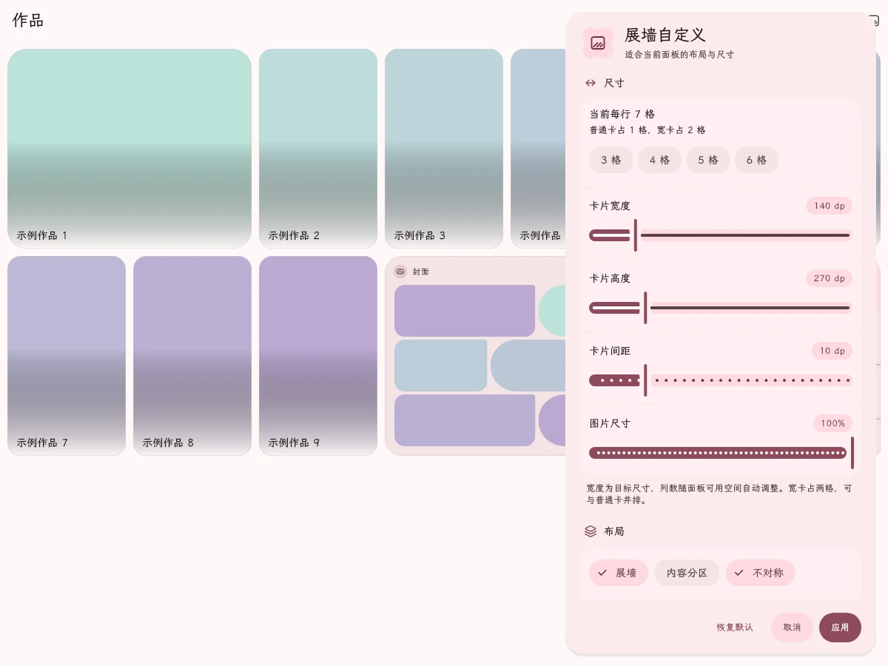</td>
    <td align="center" valign="top">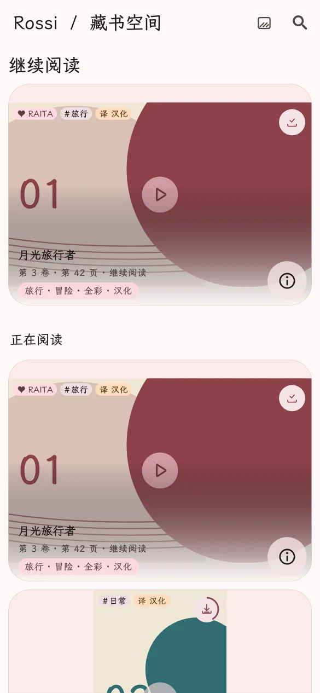</td>
  </tr>
  <tr>
    <td>阅读设置（浅色）</td>
    <td align="center" valign="top">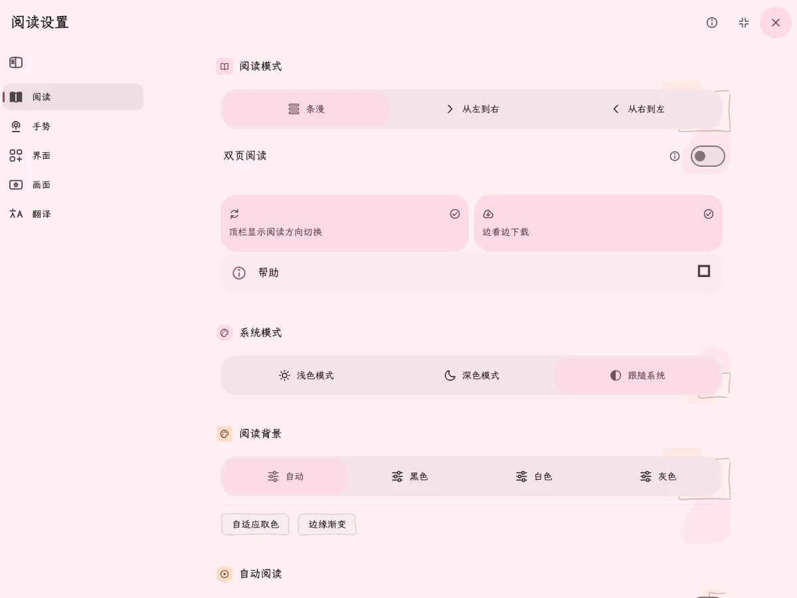</td>
    <td align="center" valign="top">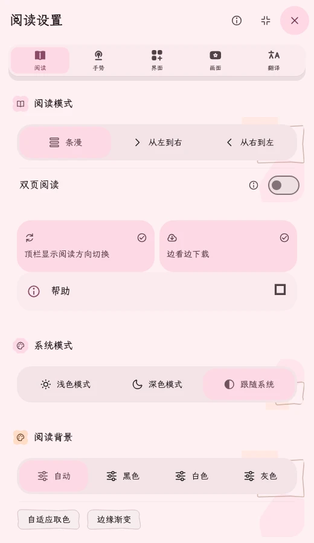</td>
  </tr>
  <tr>
    <td>阅读设置（深色）</td>
    <td align="center" valign="top">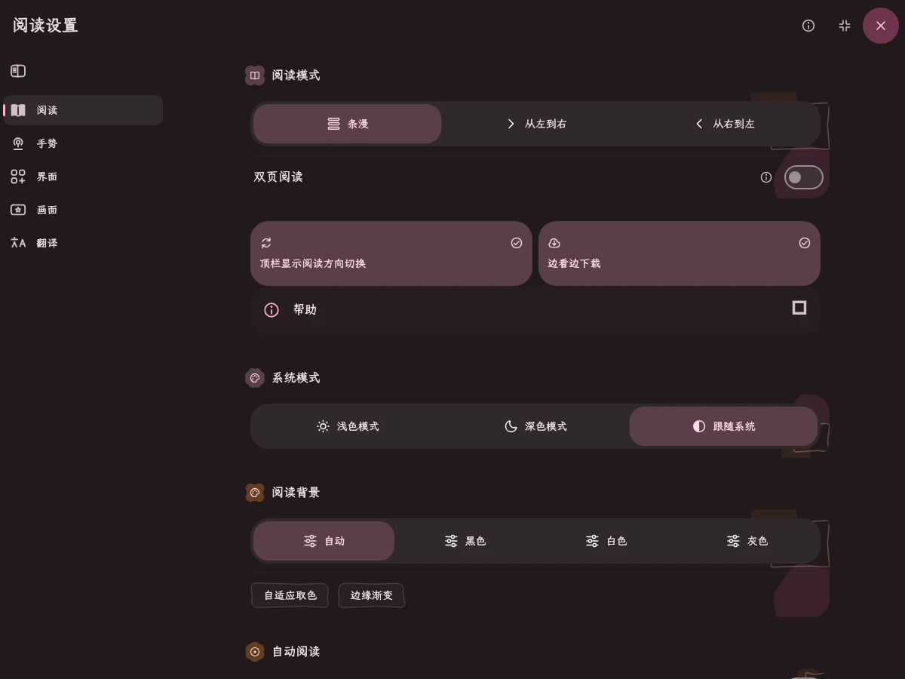</td>
    <td align="center" valign="top">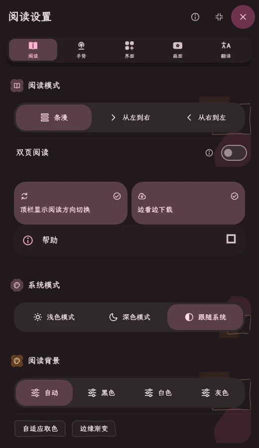</td>
  </tr>
  <tr>
    <td>信息面板</td>
    <td align="center" valign="top">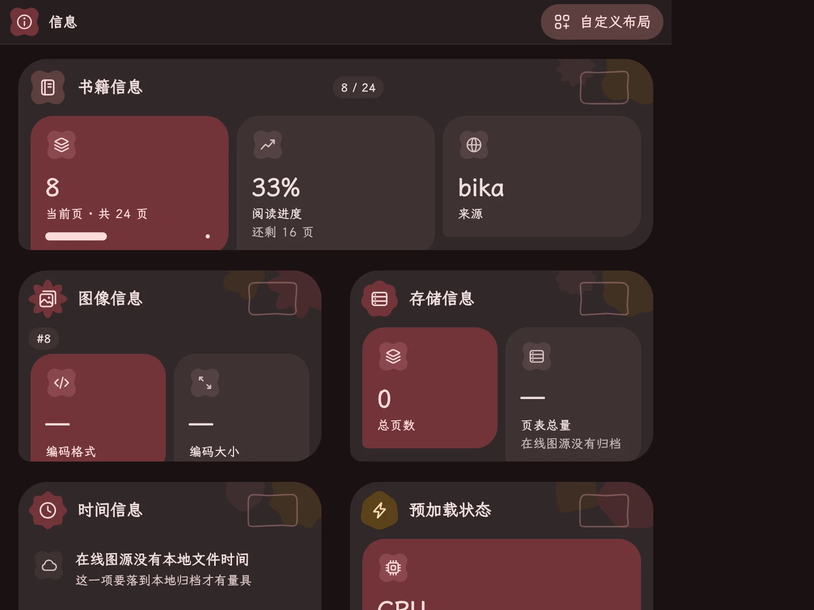</td>
    <td align="center" valign="top">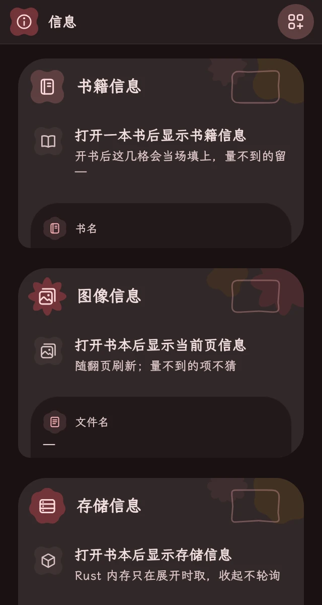</td>
  </tr>
</table>

截图来自应用内界面；书名与封面为示例数据，不含任何第三方漫画内容。

---

## 它是怎么跑起来的

<p align="center">
  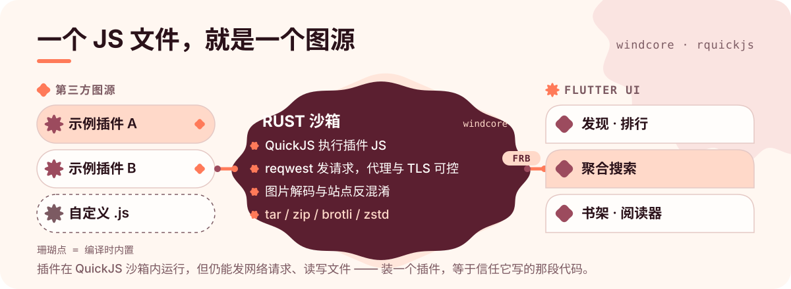
</p>

链路是 `Dart → Flutter Rust Bridge → Rust → QuickJS`。插件代码不在 Dart 里跑，也不碰平台 API：它只能描述「发什么请求、怎么解析、图片怎么还原」，网络和文件能力由宿主按 feature 授予。

> ⚠️ **插件仍是 beta 阶段**，API 可能有较大改动，目前更适合学习而非正式开发。
> 但请记住：插件在沙箱内依然能发网络请求、读写文件——**装一个插件，等于信任它写的那段代码。**

---

## 六种读法

<p align="center">
  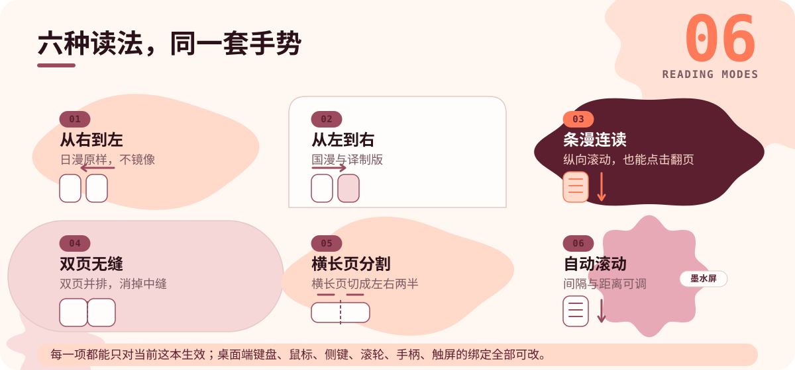
</p>

方向、翻页、双页配对、自动滚动间隔这些都不止一个开关，所以做成了「全局一份 + 每本单独覆盖一份」。桌面端还有一套完整的按键绑定编辑器，键盘、鼠标、侧键、滚轮、手柄、触屏、区域手势都能重映射。

---

<a id="ocr-details"></a>

## 漫画翻译（成品页）

<p align="center">
  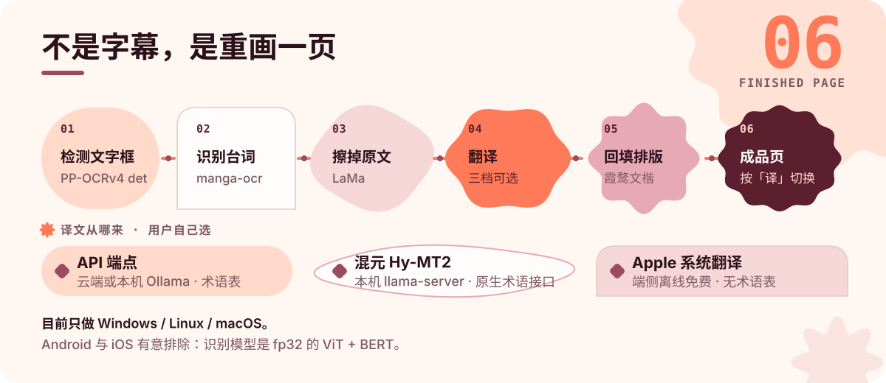
</p>

和「叠加一层翻译」的区别在于：这条路会**把原文从图上擦掉**，再按气泡形状把译文排回去，产出的是一张可以直接看的图。在阅读器工具条上按「译」，只切换当前这一页。

需要知道的限制：

- **只有 Windows / Linux / macOS 有。** Android 与 iOS 是有意排除的，不是待办——本仓的 ONNX Runtime 在 linux/android 两段没注册任何加速器 EP，而识别模型是 fp32 的 ViT + BERT，移动端要可用得先做 int8 重导出。所以入口在移动端整条不画，而不是点了报错。
- 权重不随包，约 **660 MB**，首次使用时在设置页下载（PP-OCRv4 检测 + manga-ocr 识别 + LaMa 擦字）。
- 三档译文引擎各有取舍：API 端点要网络或本机服务、支持术语表；混元 Hy-MT2 要自己起 `llama-server`；Apple 系统翻译端侧离线免费，但**没有术语表接口**，这一档下专名会按通用译法翻。
- 端点当时不可用会**降级**：那一页只做擦字与原文回填，不会卡住整本。
- 成品页有缓存，换模型或换字体后可以一键清空（不会动原图）。
- 每一页的六道关都记一行日志，出问题在设置页里能直接看到是哪一步。

---

## 下载与安装

前往 [Rossi Releases](https://github.com/HibernalGlow/rossi/releases) 获取对应平台的安装包。

---

## 参与开发

> 面向想改代码的人。只是想用，看完上面就够了。

### 1. 核心工具链

- **Flutter SDK**：需通过 `flutter doctor` 验证。
- **Rust Toolchain**：通过 `rustup` 安装，并添加相应的交叉编译 Target（如 `aarch64-linux-android`）。
- **LLVM / Clang**：涉及 `rustqjs` 等需要解析 C 头的库，必须安装 LLVM（Windows 下推荐 `choco install llvm` 或从官网下载）。

### 2. 依赖与代码生成

```bash
# 根项目 Flutter 依赖
flutter pub get

# 改过 auto_route / freezed / json_serializable / objectbox / FRB 之后必须重跑
dart ./script/code_generate.dart
```

### 3. 平台特定说明

- **Android**：确保 `local.properties` 指向正确的 SDK 路径。
- **Windows / Linux**：确保安装了 Visual Studio (C++) 或相应的 GCC 工具链，以支持 Rust 的本地编译。
- **仓库结构、构建脚本与约定**：见 [`AGENTS.md`](./AGENTS.md) 与 [`docs/`](./docs/)。

---

## 💖 鸣谢

| [](https://sentry.io/) | 本项目由 **[Sentry](https://sentry.io/)** 提供全方位的错误监控赞助，其 Sponsored Business 计划帮助我们更快速地捕获并修复崩溃，提升用户体验。 |
| :--- | :--- |

同时感谢 **[Aidoku](https://github.com/Aidoku/Aidoku)** 项目，本项目在 iOS / macOS 图片超分实现上参考了 Aidoku 的思路与模型处理方式。

---

## 开源项目免责声明

<details>
<summary>点击展开完整声明（8 条）</summary>

1. **项目性质与声明**
   本项目为开源软件，由本人独立开发并维护。项目以“原样”形式提供，开发者不对项目的功能完整性、稳定性、安全性或适用性作出任何明示或暗示的担保。
2. **责任限制**
   开发者对因使用、修改或分发本项目（包括但不限于直接使用、二次开发或集成至其他项目）而导致的任何直接、间接、特殊、附带或后果性损害不承担任何责任。这些损害可能包括但不限于数据丢失、设备损坏、业务中断、利润损失或其他经济损失。
3. **用户责任**
   用户在使用本项目时，应自行评估其适用性并承担所有风险。用户须确保其使用行为符合所在国家或地区的法律法规及道德规范。开发者不对用户因违反法律法规或不当使用本项目而导致的任何后果负责。
4. **第三方依赖与资源**
   本项目可能依赖或引用第三方库、工具、服务或其他资源。开发者不对这些第三方资源的内容、功能、安全性或合法性负责。用户应自行评估并承担使用第三方资源的风险。
5. **无担保声明**
   开发者明确声明不对本项目提供任何形式的担保，包括但不限于：

   - 适销性担保；
   - 特定用途适用性担保；
   - 不侵犯第三方权利担保；
   - 无错误或无中断运行担保。

6. **项目修改与终止**
   开发者保留随时修改、暂停或终止本项目的权利，且无需提前通知用户。开发者不对因项目修改、暂停或终止而导致的任何后果负责。
7. **贡献者责任**
   如果本项目接受外部贡献，贡献者的行为仅代表其个人立场，不代表开发者的观点或立场。开发者对贡献者的行为及其贡献内容不承担责任。
8. **法律合规性**
   用户在使用本项目时，应确保其行为符合所在国家或地区的法律法规。开发者不对用户因违反法律法规而导致的任何后果负责。

**重要提示**
在使用本项目之前，请仔细阅读并理解本免责声明。如果您不同意本声明的任何条款，请立即停止使用本项目。继续使用本项目即表示您已阅读、理解并同意本免责声明的全部内容。

</details>

---

## 许可证

- 开发者：**[windy](https://github.com/deretame)**
- 项目仓库：**[Breeze](https://github.com/breeze-project-org/Breeze)**
- 联系方式：**[telegram(电报)](https://t.me/breeze_zh_cn)**

<p align="center">
  <picture>
    <source media="(prefers-color-scheme: dark)" srcset="https://star-history.dera.page/svg?repos=breeze-project-org/Breeze&type=Date&theme=dark" />
    <source media="(prefers-color-scheme: light)" srcset="https://star-history.dera.page/svg?repos=breeze-project-org/Breeze&type=Date" />
    
  </picture>
</p>
